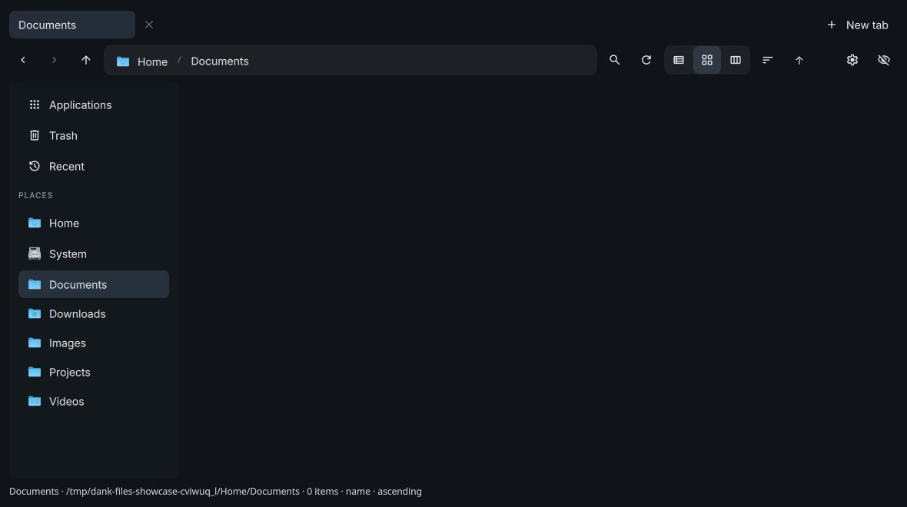

# Dank Files

A standalone file manager integrated with [Dank Material Shell](https://github.com/AvengeMedia/DankMaterialShell), built with TypeScript/TSX and Nandomo.

**Version 0.1.0 — public preview.** This repository ships the installable plugin and an application source snapshot. No build is required to install it.



## Features

- Independent window, tabs, breadcrumbs, grid/list/column views and folder search.
- System places, mounted volumes with usage indicators, and grouped Steam/Proton, Heroic and Lutris locations.
- File and folder operations, clipboard integration, drag and drop, transfer progress/cancellation and conflict handling.
- In-app applications, recent files and trash, including restoration and confirmed emptying.
- Image/PDF/video previews, image/PDF zoom, pan, rotation and reset.
- Folder icons, colors and emblems; file properties and permission editing.
- Archive creation/extraction and bulk renaming.
- Session-local undo for supported operations.
- DMS colors and configured icon theme, including inherited themes and fallback icons.
- Brazilian Portuguese, English and Simplified Chinese UI catalogs.

## Requirements

Linux, Node.js **20+**, DMS **1.5+**, Quickshell, and Qt Quick Controls/Layouts/Dialogs/PDF/Multimedia. Install GLib/GIO (`gio`), libarchive (`bsdtar`), Python 3, PyGObject and GTK 4 for the corresponding file and desktop integrations.

Optional: GVfs/FUSE and protocol backends for mounted network locations, `ffmpegthumbnailer` for video thumbnails, `udisksctl` for volume actions, and the codecs used by Qt Multimedia. Package names vary by distribution. See [installation notes](INSTALL.md).

## Install

```bash
git clone https://github.com/is-suzart/dank-files.git ~/.config/DankMaterialShell/plugins/dankFiles
```

Open **DMS Settings → Plugins**, scan and enable **Dank Files**, then add its widget to DankBar. One click opens a new window. Hovering does not launch it.

DMS must be running so the launcher can discover DankCommon. `NANDOMO_DMS_SOURCE` can point to the DMS source directory when automatic discovery is unavailable. The launcher prefers native Wayland in a Wayland session.

To launch directly:

```bash
node ~/.config/DankMaterialShell/plugins/dankFiles/app/launch.mjs
```

Register an application entry and folder support, without changing your default file manager:

```bash
node ~/.config/DankMaterialShell/plugins/dankFiles/app/register-desktop.mjs
```

## Update or remove

Finish file operations and close Dank Files before updating:

```bash
git -C ~/.config/DankMaterialShell/plugins/dankFiles pull --ff-only
```

Disable/reload the plugin in DMS after an update. To uninstall, disable it first and remove only its installation directory. Preferences remain under `$XDG_CONFIG_HOME/nandomo-file-manager` (or `~/.config/nandomo-file-manager`) for compatibility with earlier previews.

If you installed an earlier local **Nandomo Files** plugin, disable its old widget before adding Dank Files to avoid duplicate launchers. Existing windows are independent from DMS.

## Source and validation

- `plugin.json`, `FilesWidget.qml`, `app/`: ready-to-install distribution.
- `source/src/`: application TSX, domain, use cases and infrastructure.
- `source/tests/`, `source/scripts/`: development checks and packaging tools.
- `scripts/check-package.mjs`: dependency-free local package checks.

```bash
npm test
```

The QML is generated from TSX, not maintained by hand. The app source is currently developed in the Nandomo workspace; its core/bridge packages are **not yet published as standalone development dependencies**. This repository deliberately does not copy the rest of that framework. The generated runtime works independently, but rebuilding the TSX snapshot still requires the matching Nandomo workspace. See [source build notes](source/README.md).

Before publication, the application passed **139 development tests**, package relocation/widget checks and native QML workflow checks. The local package checker verifies syntax and packaging; it does not simulate a desktop session. Automated GitHub Actions are not configured in this initial publication.

## Preview limitations

Undo is session-local and does not cover every operation; replacement operations clear earlier undo history. Chinese wording still needs native-speaker review. Network behavior depends on GVfs/mount backends. Restart Dank Files after changing the OS language or DMS application icon theme.

## Browser file dialogs

The optional FileChooser portal lets applications using XDG Desktop Portal open
and save files through Dank Files. From this repository or installed plugin:

```bash
node app/install-portal-backend.mjs --enable
systemctl --user restart xdg-desktop-portal.service
```

The installer backs up the active user portal configuration and changes only
its FileChooser preference to `dank-files;gtk`. See [installation details](INSTALL.md#portal-filechooser-backend-opt-in)
for prerequisites and uninstalling. Restart browsers after enabling the portal.
Browsers using their own picker must enable portal support separately.
The chooser currently opens independently; attaching it modally to the browser
window is not implemented. The public portal-to-chooser flow was tested with
real Quickshell controls on Wayland, alongside the development and package checks.

## License

Dank Files is licensed under [BSD-3-Clause](LICENSE), a permissive open-source license. Third-party runtime dependencies retain their own licenses; see [third-party notices](THIRD_PARTY_NOTICES.md).
